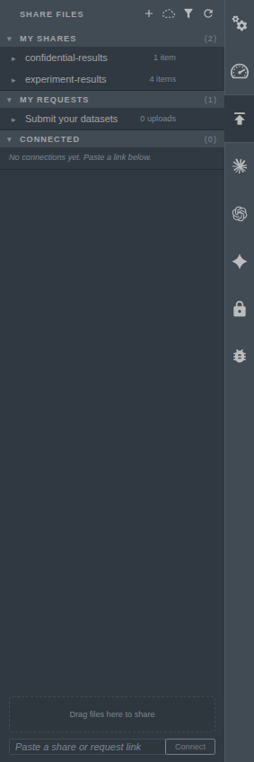
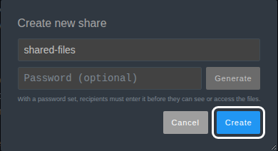
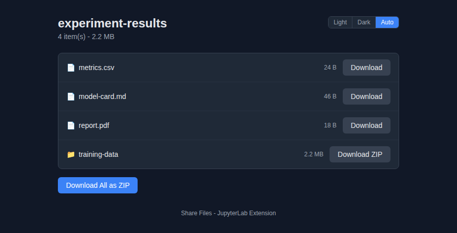
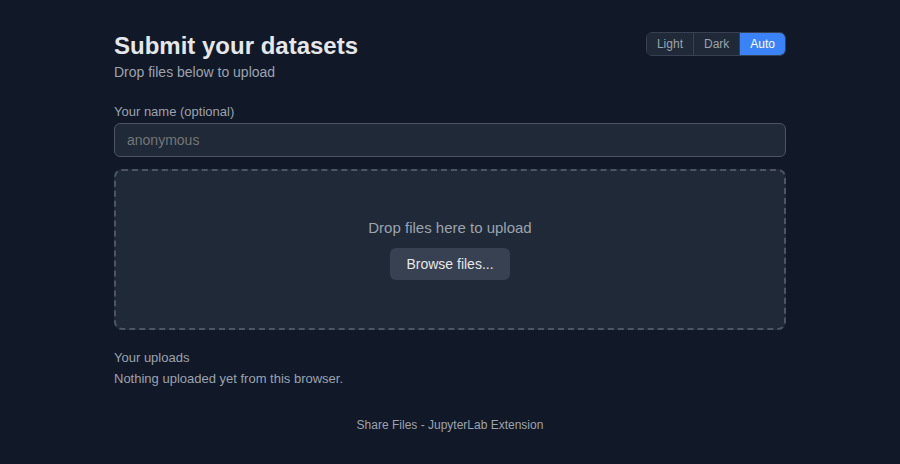
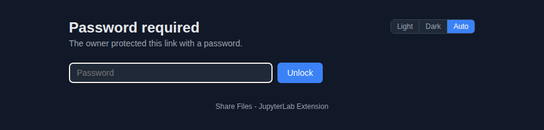
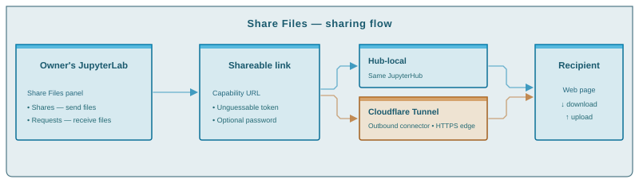

# jupyterlab_share_files_extension

[](https://github.com/stellarshenson/jupyterlab_share_files_extension/actions/workflows/build.yml)
[](https://www.npmjs.com/package/jupyterlab_share_files_extension)
[](https://pypi.org/project/jupyterlab-share-files-extension/)
[](https://pepy.tech/project/jupyterlab-share-files-extension)
[](https://jupyterlab.readthedocs.io/en/stable/)
[](https://kolomolo.com)
[](https://www.paypal.com/donate/?hosted_button_id=B4KPBJDLLXTSA)

Peer-to-peer file sharing for JupyterLab. Create a **share** (file drop) or **request** (inbox) from a side panel, copy the link - recipients open it in their own JupyterLab panel or any plain browser. The package also ships an agent skill that drives the same operations from a terminal.

## Screenshots

The Share Files panel, the create-share dialog and the recipient pages in the dark theme:

<table>
  <tr>
    <th>Side panel</th>
    <th>Dialog and recipient pages</th>
  </tr>
  <tr>
    <td valign="top" style="vertical-align:top"></td>
    <td valign="top" style="vertical-align:top">
      <br>
      <br>
      <br>
      
    </td>
  </tr>
</table>

The recipient pages open in any browser and follow the system theme by default, with a Light / Dark / Auto switch.

## Features

- **Shares and requests** - read-only drops of files and folders, and upload inboxes with a per-uploader identity on the recipient page
- **Side panel** - create, browse, rename, download, save as zip and delete to trash; drag files from the file browser; Tab and Enter reach every row and menu
- **Connections** - paste a peer's link to save from its share or upload to its request; a self-signed certificate is offered with its SHA-256 fingerprint and pinned once you trust it
- **Passwords** - optional per record, generated as an xkcdpass passphrase, rate limited on the server
- **Recipient pages** - standalone HTML in any browser, no JupyterLab needed, Light / Dark / Auto
- **Streaming transfers** - share downloads, zips, uploads and connected saves move through disk or the response, never the server's memory
- **Cloudflare tunnel** - optional public links, HTTPS-only, restricted to the public endpoints ([setup guide](docs/cloudflare_setup.md))
- **Hub mode** - on a galaxahub lab the hub holds the bytes and the lab mounts no public route ([design](docs/design-hub-public-zone.md))
- **Settings** - poll interval, download limit, hidden files, tunnel autostart

A link is served by the JupyterLab server that created it, so it works only while that server runs.



## Requirements

- JupyterLab >= 4.0.0
- Python >= 3.9

## Install

Developers (project `Makefile`):

```bash
make install
```

End-users (PyPI):

```bash
pip install jupyterlab_share_files_extension
```

## Agent skill

The package ships the `jupyterlab-share-files-extension` skill. It points an agent at the CLI help and adds only the rules the help cannot enforce: which commands print a password or a long listing, which cannot be undone, and when to ask the user first.

The skill is in the repository at `.agents/skills/jupyterlab-share-files-extension/SKILL.md` and in the wheel at `<sys.prefix>/share/jupyter/agents/skills/jupyterlab-share-files-extension/SKILL.md`. Link it where agents read skills.

After `pip install`, with the Python that runs the lab:

```bash
mkdir -p ~/.agents/skills && ln -sfn "$(python -c 'import sys; print(sys.prefix)')/share/jupyter/agents/skills/jupyterlab-share-files-extension" ~/.agents/skills/jupyterlab-share-files-extension
```

From a clone, into Claude Code:

```bash
ln -sfn "$PWD/.agents/skills/jupyterlab-share-files-extension" ~/.claude/skills/jupyterlab-share-files-extension
```

## CLI

`jupyterlab_share_files` - the panel's operations as subcommands, a thin client over the same authenticated HTTP API for scripts and agents. `--help` lists every command and says how standalone and hub mode differ.

- **`SHARE_FILES_BASE_URL`** - the Jupyter server URL; on JupyterHub use the public user URL, e.g. `https://hub.example.com/user/<name>/`; falls back to `JUPYTER_SERVER_URL`
- **`SHARE_FILES_TOKEN`** - the API token; falls back to `JUPYTERHUB_API_TOKEN`, then `JUPYTER_TOKEN`
- **`SHARE_FILES_INSECURE`** - `1` skips TLS verification for a self-signed certificate

```bash
jupyterlab_share_files list-items
jupyterlab_share_files create-share <name> [paths...] [--password PW | --generate-password]
jupyterlab_share_files create-request <name> [--password PW | --generate-password]
jupyterlab_share_files add-files <share-id> <paths...>
jupyterlab_share_files set-password <share|request> <id> [PW] [--generate] [--clear]
jupyterlab_share_files connect <link> [--trust-certificate]
jupyterlab_share_files pick-up <key> [names...] [--target-dir DIR]
jupyterlab_share_files close-share <id> | close-request <id>
```

## Configuration

Optional, in `jupyter_server_config.py`:

```python
c.ShareFilesConfig.shares_dir = "uploads"        # default - relative to the notebook root
c.ShareFilesConfig.use_trash = True              # default: True
c.ShareFilesConfig.excluded_names = [".ipynb_checkpoints", "__pycache__"]  # replaces the default catalogue
c.ShareFilesConfig.verify_peer_tls = True        # default: True
c.ShareFilesConfig.password_max_attempts_per_minute = 30   # default: 30
c.ShareFilesConfig.password_attempt_cooldown_seconds = 1   # default: 1
```

- **`shares_dir`** - storage for shares, requests and connections, resolved inside the notebook root; created on first use
- **`use_trash`** - `False` deletes permanently instead of moving to the OS trash
- **`excluded_names`** - names a share never copies, matched with `fnmatch`; replaces the whole default catalogue, and `[]` copies everything
- **`verify_peer_tls`** - on by default; `False` skips the certificate question for every peer
- **`password_max_attempts_per_minute`** / **`password_attempt_cooldown_seconds`** - per-resource rate limiting of password attempts
- **`pollIntervalSeconds`** - panel refresh interval in the Settings Editor (default 15, minimum 2)
- **`tunnelAutostart`** - bring the Cloudflare tunnel up at server startup (default off)
- **`peerDownloadMaxGb`** - the largest download from a connected share (1, 2, 5, 10, 20, 50 or 100 GB; default 10)

## Cloudflare tunnel sharing

The `cloudflare` command exposes links through a Cloudflare tunnel: an outbound-only connector, HTTPS at the edge and ingress restricted to the extension's `/public/...` endpoints. Full guide: [docs/cloudflare_setup.md](docs/cloudflare_setup.md).

```bash
jupyterlab_share_files cloudflare setup --token <api-token> --account-id <account-id> \
  --hostname share.example.com --private-base-url "https://hub.example.com/user/<name>/"
jupyterlab_share_files cloudflare validate
jupyterlab_share_files cloudflare start   # public links
jupyterlab_share_files cloudflare stop    # private links
```

The cloud icon in the panel header is the switch. The account token needs `Account → Cloudflare Tunnel → Edit` and zone-scoped `DNS → Edit`.

## Hub mode

A lab spawned by galaxahub carries `SHARE_FILES_PUBLIC_ZONE=hub`, `SHARE_FILES_HUB_API` and its own `JUPYTERHUB_API_TOKEN`. The extension registers only its authenticated `api/*` routes and calls the hub for every record; the hub stages the bytes and serves the recipient pages. Design: [docs/design-hub-public-zone.md](docs/design-hub-public-zone.md).

## Security

- **The link is the credential** - 40 bits of entropy, no expiry; share it over a trusted channel
- **Optional password** as a second factor; the unlock token is keyed on the password, so changing it locks out every old holder
- **Pinned peer certificates** - a certificate trusted at connect is the only one that connection accepts
- **Cloudflare exposure** is HTTPS-only and limited to the public endpoints; the connector token travels only in `TUNNEL_TOKEN`

## Releases

Versioned releases ship to [npm](https://www.npmjs.com/package/jupyterlab_share_files_extension) and [PyPI](https://pypi.org/project/jupyterlab-share-files-extension/) together, tagged `RELEASE_v<version>`. Full delivered feature list: [RELEASE.md](RELEASE.md); per-version changes: [CHANGELOG.md](CHANGELOG.md).

## Uninstall

```bash
pip uninstall jupyterlab_share_files_extension
```
