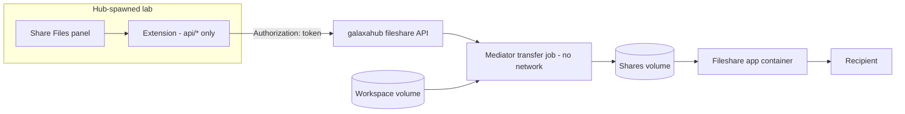

# Design - Hub Mode

The extension runs in one of two modes, decided once at server start. On a standalone JupyterLab it serves recipients itself from the notebook root. On a lab spawned by galaxahub it mounts no unauthenticated route at all and every panel action goes through the hub's fileshare API, which stages the bytes with its own transfer job and serves recipients from its own app container. The lab never holds a share byte and never carries a recipient request.

## Two modes

|                                              | Standalone                       | Hub                                                                                                 |
| -------------------------------------------- | -------------------------------- | --------------------------------------------------------------------------------------------------- |
| Signal                                       | `SHARE_FILES_PUBLIC_ZONE` absent | `SHARE_FILES_PUBLIC_ZONE=hub`, injected by the hub at spawn                                         |
| Who can set it                               | nobody needs to                  | only the hub - the name is reserved against users and groups                                        |
| `api/*` routes (authenticated)               | local store                      | proxied to the hub                                                                                  |
| `public/*` and `static/*` routes             | mounted                          | not mounted - jupyter_server answers 404                                                            |
| Store directory                              | created on first use             | never created                                                                                       |
| Per-user Cloudflare tunnel                   | optional                         | never started; the tunnel is the hub's                                                              |
| Connections to another user's record         | through the peer lab's link      | through the hub record's link, read as a browser reads it; a link of this hub through the hub proxy |
| Fallback when the hub contract is incomplete | n/a                              | none - stays in hub mode, hub calls fail with `hub_unavailable`                                     |

The mode decision depends on the spawn variable alone. A missing API path or token never remounts the standalone routes - that would be the exact bypass hub mode exists to close.

## The spawn contract

galaxahub injects three things into every lab it manages; the extension reads them once.

- **`SHARE_FILES_PUBLIC_ZONE=hub`** - selects hub mode (`hub.hub_mode()`)
- **`SHARE_FILES_HUB_API`** - the path of the hub's fileshare API (`/hub/api/fileshare`); joined with the scheme and host of `JUPYTERHUB_API_URL`; an absolute value is used verbatim (`hub.hub_api_base()`)
- **`JUPYTERHUB_API_TOKEN`** - the lab's own token; every hub request carries `Authorization: token <it>`, set in one place (`hub.HubClient.request`)
- **Hub side** - the fileshare handlers accept token authentication (`_accept_token_auth = True`, galaxahub v4.4.56); a call without a token answers 403

## What the lab mounts in hub mode

`routes.setup_route_handlers` builds one of two tables and never mixes them. The hub table (`hub_routes.hub_handlers`) holds `APIHandler` subclasses, every method wrapped by `tornado.web.authenticated`, and one websocket handler, `api/stream`, whose `get` is wrapped by `ws_authenticated`.

| Panel call                                   | Hub call                                                                                     | Notes                                                                                                        |
| -------------------------------------------- | -------------------------------------------------------------------------------------------- | ------------------------------------------------------------------------------------------------------------ |
| `GET api/info`                               | `GET capabilities`                                                                           | `mode: hub`, grants, refusal reason, serving verdict, password requirement, toggle state                     |
| `WebSocket api/stream`                       | `GET stream`                                                                                 | the change stream, one hub connection per lab (below)                                                        |
| `GET api/tunnel`, `POST api/tunnel`          | `GET capabilities`, `GET items`, `PUT <kind>/<id>/tunnel` per record                         | the tunnel toggle - flips every record of the user and the stored default                                    |
| `GET api/link-check`                         | `GET items`, then a GET of the record's `url` from the lab server                            | reachable = the link answered 200; no redirect followed                                                      |
| `GET api/shares`                             | `GET items`                                                                                  | hub rows of kind share                                                                                       |
| `POST api/shares`                            | `POST shares {title, paths, password}`, then `PUT shares/<id>/tunnel` while the toggle is on | paths only, never bytes; 202 becomes a `staging` row                                                         |
| `GET/DELETE api/shares/<id>`                 | `GET items` / `DELETE shares/<id>`                                                           | 204 removes the record and the bytes                                                                         |
| `POST/DELETE/PUT api/shares/<id>/items`      | `POST shares/<id>/content {action: add\|remove\|rename}`                                     | add answers 202 and lands later; remove and rename answer 204; a rename to a name under another folder moves |
| `PUT api/shares/<id>/name`                   | `PUT shares/<id>/title`                                                                      | answers 204; the id, link, password and files stay; a title over 200 characters is refused with 400          |
| `GET api/requests`                           | `GET items` + `GET requests/<id>/uploads`                                                    | one uploader group per request                                                                               |
| `POST api/requests`                          | `POST requests {title, password}`, then the same tunnel switch                               | 201 `ready`                                                                                                  |
| `GET/DELETE api/requests/<id>`               | `GET items` / `DELETE requests/<id>`                                                         |                                                                                                              |
| `GET/POST api/<kind>/<id>/password`          | `PUT <kind>/<id>/password`                                                                   | the value read back is the one set in this server process                                                    |
| `POST api/requests/<id>/uploads/<uid>/fetch` | `POST .../fetch {dest}`                                                                      | the lab picks a fresh directory under the folder the panel names                                             |
| `GET api/generate-password`                  | none                                                                                         | local                                                                                                        |

Not mounted, because the hub has no equivalent: removing a single upload, tunnel setup and reset.

A connection to another user's share or request does not go through the hub API, which answers 404 for a record the caller does not own. The lab server reads the record's public link - its page, `/unlock`, `/d/<path>`, `/archive` and `/u` - as a recipient's browser does, with no hub token. A link on the origin the browser reached the lab on is this hub's own, and a net-isolated lab cannot open the public address: the lab reads that link's path at the origin of `JUPYTERHUB_API_URL`, which the hub points at its proxy (`http://hub:8000`), over plain http with no certificate step (ACC-HUBM-196). A link of this hub under another access name counts as another host.

An upload into a connected request goes from the lab, one file per POST to `/u`, after the lab has answered the drop. `_UPLOADS[key]` keeps each file's name, size and bytes sent, and the index of the file in flight; while it runs the manifest answers `files`, each as `{name, size, fraction}`: 1 before the index, the part of the file at the index sent so far (bytes sent over its size, at most 1, because the lab reads the size at the drop and sends the file to its end), 0 after it, and a zero-size file not yet sent is at 0. The panel draws them as rows in transit in the open request (ACC-PROG-216), and the upload opens the request's row once, as an add does. A folder of many files would draw thousands of rows each second, so the manifest answers at most 100 rows (`UPLOAD_ROWS`), starting at most 50 rows before the file in flight; once the upload ends `files` is empty.

## Editing a share

The hub lists a share's files flat, a nested name holding `/`; the panel derives the folder view and folders exist only as name prefixes.

- **Add** - the lab applies the excluded-names catalogue to the chosen items, leaves out a chosen name starting with `.` or `~`, refuses by name a name the share already holds, a name still copying or held, and two items of one name (the hub refuses a taken name without naming it and drops the second of two names after its 202), then sends the add. An added item lands at the top of the share under its own name, whatever folder the share shows, because the hub takes no target folder (probed 2026-11-03). So a drag of workspace items over a folder row marks the share and not the row; a folder row is marked only for a move of an entry of the same share. A standalone lab adds into the folder a drop or a paste targets (ACC-EDIT-232)
- **Names starting with `.` or `~`** - the hub refuses a whole add over one such chosen name with `bad_filename`, and a create skips it and counts it in `skipped`; a dot-named parent is not checked. So add and create both leave the name out, the catalogue's names stay dropped with no mention, and the answer carries `left_out`, which the panel shows once as `A hub share takes no name starting with . or ~. Not added: <names>`. The lab's toast cuts a message at 140 characters, so a longer notice carries a `Show all` button that opens the whole sentence. When nothing is left the lab answers 400 with that sentence and the hub is not called, so a create of only such names makes no share
- **The state of an add** - the hub's share row carries `last_add` (`running` while it copies, then `done` or `refused` with the reason slug a refused create carries) and `progress` (`copied` and `total` bytes, present only while bytes move), and it rings the owner's stream once a second during a transfer and when an add settles, refused or landed. The lab relays `adding` (the hub reports `running`, or the share's task is alive), `add_reason` (the newest refusal: the task's `reason`, else the hub's), `progress` and `pending`; the panel shows a spinner and the word `adding` and tints the row by `progress` (ACC-PROG-172), raises one notice when a row first carries a refusal, and keeps the refusal on the row until a drop after a read has carried it. While a row reads `adding` or `staging` the panel reads the share list once a second, so a row leaves that state with no ring (see the change stream below). On an add `password_required` and `password_wrong` mean the lab no longer holds the share's password, so the panel gives the lab's sentence with the remedy (Change Password), as the direct answer does. On create and on add the lab sends `exclude`, the plain names of its excluded-names catalogue (the hub takes no pattern, at most 64), which the hub applies below the sent paths; the chosen items themselves are filtered by the lab
- **Back-to-back adds** - the hub answers `busy` to every content call on a share while an add runs or the row reads `staging`, so the lab holds a further add and the panel holds nothing: a page reload, a second tab and the CLI all see the same row. `_ADDS[share id]` keeps `sent` (the names and sizes of the create or add last accepted), `held` (the drops waiting, in order), `reason`, `shown` (the refusal the last read carried), a lock and the share's one task; a hold is that task being alive. A drop holds it through its read of the row, its name check and its send, and the task holds it for each send, so a drop reads a name as held or as sent and two tabs cannot pass the same name. A name the row lists is refused with `The share already holds <names>`, and a name only copying or held with `The share is still adding <names>`, because the share does not hold it yet. A drop joins `held` while the task is alive. Otherwise a row that reads `running` or `staging` holds it and starts the task with no send, because an accepted add replaces the hub's `last_add`, so a send follows a read that shows the last add settled. Any other drop goes to the hub, and a `busy` answer holds it and starts the task the same way. The task sends the held adds one drop at a time and ends once the row shows the last one settled, with a ring so the row leaves `adding`. The task reads the row once a second and sends the next add when the row shows the last one settled, because an accepted add replaces the hub's `last_add`; a refusal the row shows goes into `reason` first, so `reason` is always the newest refusal. After an accepted send it waits a second before its next read, because the row reads `running` 0.01 to 0.02 s after the 202 and a read inside that window would call the add settled. It asks again once a second while the hub answers `busy` or cannot be reached (no answer, or a 502, 503 or 504), so an outage delays the held adds and loses none. It sends nothing until a read of the items answers, and an `items` value that is not a list is a failed read. Five 502, 503 or 504 answers in a row to one add, with a read answering before each, are a refusal with the hub's reason or `no_reason`, because the hub answers 502 by itself for a failed fetch. The row is read once more before that refusal. An add whose answer did not arrive may have reached the hub, so a row that lists one of its names counts as the hub's acceptance and the add does not go again; `sent` is emptied at that answer, because the task sends only once the row shows the last add settled, so the old names are not copying any more. A held add the hub refuses keeps its slug in `reason`, or `no_reason` when the hub names none, a row's `last_add` with no slug reads the same, and the next one is still sent; a 404 on an add is such a refusal while a read lists the share, because it can mean the add's path. A drop clears the refusal once a read has carried it, because a later add may land while the refusal stays on the row. The panel reads 300 ms after a ring, so a drop inside that gap keeps the refusal, and copies the hub's into `reason`, because its add replaces the hub's record. A read of the items with no row for the share may be a hub fault, so it ends nothing alone: a held add still goes, and a 404 to that send ends the task and removes the entry. With nothing held the task ends and the entry stays. Deleting the share removes the entry too. A task that dies on an exception stores `lab_failed`, empties `held` and rings, so the row says the lab could not send the add, not that the hub refused it, and a drop of the same names is taken. `pending` lists `sent` while the row reports `running` or `staging`, then `held`, as `{name, size, held, fraction}`; size is the file's, or the sum for a folder, without the catalogue's names
- **Rows in transit** - the hub lists an add's files only in the read where the add lands, all at once, and reports one `progress` for the whole add with no field naming the file it copies, so the panel draws one row for each item of `pending` after the listed entries, at the top of the share, with the progress layer of ACC-PROG-172 over it (ACC-PROG-217). The lab keeps the highest `copied / total` it read for the add as `seen`, because the hub reports no progress for the first 2.6 s and again just before the add lands, so a fraction never goes back; an accepted add, sent at once or by the task, sets `seen` to 0, and only a row that reads `running` or `staging` changes it. The fractions assume the hub copies the items in the order sent, which it does not report: `seen` times the sum of the lab's sizes is the bytes done, and an item's fraction is the part of its size past the items before it. So a hub total that differs from the lab's sizes, as when the hub skips names inside a folder, still ends every item at 1. A zero-size item is whole once the copy reaches it, and a held item is at 0. A finished item shows no layer and a waiting one a layer of no width. A name the share lists already is drawn once, as the listed entry, and a share with rows in transit shows no empty-share line. A row in transit takes no click, menu, drag, keyboard focus or remove button. An add the panel sends, a held one included, opens a closed share row once, at the top of the share, whatever folder it was closed in (ACC-PROG-229), and a close by the owner stands
- **Remove, rename, move** - synchronous on the hub, which rings the change stream after each; a refusal carries the hub's slug (`name_taken`, `unknown_entry`, `bad_filename`, `busy`)
- **Selection** - ctrl-click or cmd-click toggles an entry, shift-click selects the entries from the last clicked one, a plain click selects one entry alone, and Space toggles the focused entry; the `..` row and the rows in transit take no selection. The selection belongs to one folder of one share: an entry no longer listed leaves it at the next render, and another folder or share clears it. The remove button, the Delete key and the menu's Remove from Share act on the selection when their entry is in it, and on that entry alone otherwise; two or more entries ask once with their count. The panel sends the names in display order, at most 50 to a call so the query string stays short. The lab sends one content call per name and stops at the first refusal, so the names before it stay removed and the names after it stay listed; the panel shows the refusal once and reads the list again (ACC-EDIT-210 to 215, 224, 227, 228)

## Links and the tunnel switch

Every hub record carries its own tunnel switch (`tunnel`, galaxahub ACC-FILE-2920): off, the record serves on the hub's own address alone; on, the hub composes its link on the tunnel hostname once its connector is serving, and on its own address before that; `capabilities.public_base_url` is always the hub's own address and confirms nothing. The hub mints every record with the switch off, and the tunnel runs only while some record has it on. The hub owns the state - it reports whether a tunnel exists at all and whether it is up - and the lab reads that verdict instead of waiting for one. The lab never composes a link; it restores the address recipients can use.

- **Hub's own address** - the hub composes a row's `url` from the Host header of the request it answers, so a lab-originated call yields the hub's internal address; an origin equal to the hub API origin is replaced by the origin the browser reached the lab on (forwarded headers, else the request host) plus the hub path `/s/<policy id>/<id>`, where the policy id names the group's file-sharing policy and the record id is the last segment
- **Tunnel address** - any other origin is the hub's choice for a record switched on and is kept as composed
- **Toggle** - the header cloud icon is the bulk switch: `POST api/tunnel {active}` flips every record of the user through the hub and stores the state in the CLI config file (`hub_tunnel`); a record created while the toggle is on is switched on right after the hub minted it and answers with the url the hub composed for it. The tunnel is one state for every record: a list read switches any record that differs from it, on or off, except that it does not switch on a record that reads `staging` or has an add `running`, which reads `tunnel_pending` instead, because the hub answers `busy` to that switch and the panel reads a copying row once a second. At lab start the state is the `tunnelAutostart` setting, which `POST api/tunnel {autostart}` stores as `tunnel_autostart` (DEF-HUB-130)
- **Refusal** - the hub refuses a switch on with `tunnel_not_available` while the owner's group policy has Cloudflare off; the toggle relays the 403 and turns the stored default off, and a create leaves the row off and carries `tunnel_reason` so the panel says why the link stayed on the hub network. That reason is the hub's own slug, or `tunnel_not_switched_on` when the hub answered an error without one, or `hub_unavailable` when it did not answer, or `tunnel_pending` when the hub answers the switch `busy` or `rate_limited`, and the next list read switches the record on; a switch off is never refused
- **No confirmation wait** - for the tunnel the lab holds no per-record state, and it runs no wait: a create makes one switch attempt, and the next list read finishes a switch the hub answered `busy` or `rate_limited`. `CloudWait`, its 5 s poll and its 120 s bound were deleted when the hub began reporting `tunnel_ready` itself, so the panel learns the tunnel came up from the next `api/info` or change-stream ring rather than from a wait the lab ran
- **State** - `api/tunnel` and `api/info` report `tunnel_available` (the group policy has a tunnel at all), `tunnel_ready` (the hub's connector is up and serving) and `tunnel_default` (the lab's stored default). The four standalone fields `tunnel_configured`, `tunnel_active`, `tunnel_autostart` and `tunnel_running` keep their names in the hub payload; `tunnel_active` there carries the same value as `tunnel_default`, and the panel reads the three hub fields
- **Header icon** - six looks, each with a tooltip of two lines at most: hidden when the group policy has no tunnel, on when the default is on and the hub is ready, pending when the default is on and the hub is not ready yet for a record that asked for a tunnel, or a switch is in flight, armed (the still off silhouette; the tooltip tells it from off) when the default is on and no record asks for a tunnel, off when the default is off, and unreachable (a struck-through cloud in the warning colour) when the hub does not answer. `aria-pressed` is true on, `mixed` while a switched-on record waits for the hub, and false otherwise. The icon is never green: on carries the accent colour and pending the dashed silhouette, so the two states differ by glyph rather than by hue
- **Link check** - `GET api/link-check` finds the record in `GET items` and opens its `url` from the lab server with the standalone probe (`routes.probe_link`: 10s timeout, no redirect followed, certificate not verified): the tunnel hostname through Cloudflare. The dialog asks only for a tunnel link: a link on the browser's own origin is the hub's own address, which the lab cannot open (the hub API port answers `/s/<policy id>/<id>` with a 302 to `/hub/s/<policy id>/<id>`), so the dialog says it works on the hub's network only, or, for a record switched on while the hub's tunnel is not up yet, that it moves to the Cloudflare hostname once the hub confirms, and does not probe it. `reachable` is true only for a 200; a failure answers the `status` or an `error` (`no answer within 10 s`, `connection refused`, `no address for the host name`, `a TLS error`, `a closed connection`, `a network error`), and the dialog says what answered and names the address opened only when it differs from the link it shows. `capabilities.serving` plays no part - it is cached on a 30s tick and reads false on a fresh deployment while the link already works. A GET of the recipient page renders it and changes nothing (galaxahub fileshare `app.share_page`: no view count, no event, no download, no password attempt); it charges one token of the page's per-address lookup rate limit, as any recipient's GET does. Each opening of the dialog checks again

## Change stream

The hub tells a lab when any of its records changed (galaxahub ACC-FILE-2919); the panel fetches on a ring instead of on a timer, so a lab costs the hub nothing while nothing changes.

- **One hub connection per lab** - `hub_stream.RELAY` opens `GET stream` on the hub when the first panel subscribes and closes it when the last one leaves; every ring is fanned out to every open panel stream as one `changed` message, and the open itself rings so a reconnect refetches
- **Raw socket, not the tornado client** - a tornado fetch cannot be cancelled and the hub never ends the stream, so a stream the last panel left behind would hold a slot of the shared client until the hub died; the relay speaks HTTP/1.1 over an asyncio socket, de-chunks the body and closes the socket on cancel. A read that waits longer than three hub keepalives (90s) is a vanished hub and reconnects
- **Panel stream** - `api/stream` is a WebSocket, because an open HTTP request holds one of the browser's six connections per origin in every tab: three tabs of Server-Sent Events and of the commands extension's long poll held all six, and an add's POST waited up to 21.9 s (DEF-HUB-141-ADD-SLOW). A WebSocket counts against none of the six. One text message, `changed`, per ring, with no payload; `WebSocketMixin` sends the pings and refuses another origin, `ws_authenticated` refuses an anonymous connection, and a closed socket unsubscribes. A frame from the client is dropped, because tornado's default answer to one aborts the socket and logs its URI, which can hold the token
- **Panel** - one `WebSocket` per attached panel in hub mode; the timer is stopped while it stands. A ring schedules one fetch after 300ms so a burst costs one; the open fetches too, so a ring lost while disconnected is covered. A WebSocket does not reconnect by itself: a socket that closes (a refused open, a lost connection, the lab restarting behind the proxy) puts the panel on the timer until the next refresh reopens the stream. A detach closes the socket
- **Rows that copy** - the end of an add or a create reaches the panel by a ring and by its own read, so the row follows the hub whatever the stream does. After any read that shows a row reading `adding` or `staging` the panel arms one timer, which reads the share list a second later, that list alone, applies the rows as a refresh does and arms itself again. It stops when no row copies and on detach; a stream failure does not stop it, and neither does a read that throws: the next read follows a second later while the last rows read showed a row copying. Each add the hub accepted is read by a timer armed after it, whatever the read after its answer showed, because the hub reports an add 0.01 to 0.02 s after its answer. Each read of the share list is stamped when it starts, and its rows are applied only if no newer read has been applied
- **Retry** - a hub that cannot be reached, or answers anything but a stream, is retried every 5s while a panel listens
- **What rings** - the hub rings when a record changes, when its serving verdict flips, once a second while a transfer of the owner's runs, and when an add settles; the lab rings its own panels when an add is held, after each step of the held adds and when the task ends, because the hub rings nothing for a refused call
- **Connected rows** - the hub rings nothing when another user changes their record, so the panel reads connected rows on its poll interval, and once a second while it sends an upload into one
- **Standalone** - unchanged: the timer

## Password policy

A group may require a password on every record (galaxahub ACC-FILE-2927); `capabilities.password_required` rides on `api/info` as `hub.password_required`.

- **Create dialog** - the password field is required and starts with a generated passphrase; an emptied field keeps Create disabled, so no create reaches the hub without one
- **Change dialog** - the password field is required, the hint names the rule and offers no removal; an empty field keeps Save disabled, including one the dialog opened empty
- **Relay** - the hub's 400 `password_required` on a create or a password removal is relayed with its reason, which the panel names

## Errors

The hub refuses with `{reason, message}` from a closed slug set; the lab relays the status and the slug.

- **403, 400, 404, 429, 503** - status and message kept, `reason` added when the hub named one
- **Hub unreachable** - 502 with `reason: hub_unavailable`; `api/info` still answers 200 with `hub.available: false` so the panel keeps its last view
- **Panel** - `hubReasonText` turns a slug into a sentence, including `password_required`, `tunnel_not_available`, `policy_conflict` and the lab's own `tunnel_not_switched_on`; the slug rides on the thrown error as `reason`; the New menu greys out a refused kind with the reason; a refused share row shows the sentence on one line, with the slug in its hover
- **Outage on Refresh** - a Refresh the user clicked that fails with `hub_unavailable` shows one warning and the icon's hub-unavailable look; a background refresh only updates the icon

## Enforcement

The invariants are pinned by tests, not by review.

- **Route table** - hub mode registers no pattern under `public/` or `static/`, no `_PublicBase` or `StaticFileHandler`; every method the extension implements on a registered handler carries `authenticated` (`tests/test_hub_mode.py`)
- **Fail closed** - hub mode with the token or the API path missing still mounts no public route (`tests/test_hub_mode.py`)
- **Handlers** - driven through a live jupyter_server against an in-memory hub: shapes, refusal relay, links, the toggle, the confirmation wait (one ring on confirmation, bounded item reads and none while idle, one wait for two switch-ons, the timeout revert and its reason, no wait for a confirmed link or without a record), the link check against a loopback recipient page, the password requirement, fetch, the panel stream (`tests/test_hub_handlers.py`)
- **Stream** - the relay's lifecycle against a scripted hub and the raw read against an in-process SSE server, including that a cancel closes the socket, that a 404 leaves the relay not connected and that a malformed status line is retried (`tests/test_hub_mode.py`)
- **End to end** - galata against a mock hub over HTTP: 404 on the recipient paths, panel state badges, grants, fetch, the link dialog reachable while the hub reports serving false and naming what answered when the page fails, the toggle with no row mark, the pulse until the tunnel registers and the tunnel link on a second open page without Refresh, the timeout warning and the off icon, the busy icon on a switch off, a policy refusal as a warning, two-line tooltips, the outage warning on a clicked Refresh, no timer while the stream stands and one fetch per ring, the required password, an empty share filled by a drop, an add the hub drops, rename, move and remove, the selection and its removal (`ui-tests/tests/hub`, `ui-tests/mock_hub.py`); CI runs it beside the standalone suite
- **Standalone** - the 27-route table with its public and static routes, and every pre-existing test, unchanged

## Residual

- **Process restart** - passwords set through the panel are held in memory; after a restart the dialog shows the link without the value (the hub stores only a hash)
- **Held adds** - they live in the lab process, so a lab restart loses them; the files stay in the workspace and the owner drops them again
- **Mode is read from the environment** - a user with a shell cannot change it for the running process; a restart goes through the hub, which re-injects it. Persisting a modified extension across respawn is an image-integrity question, not this design's
- **Hub-side backstop** - the hub's proxy could refuse `jupyterlab-share-files-extension/public/*` for every user, not only download-blocked ones; that change belongs to galaxahub
